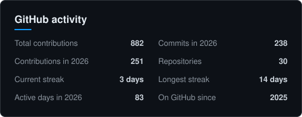
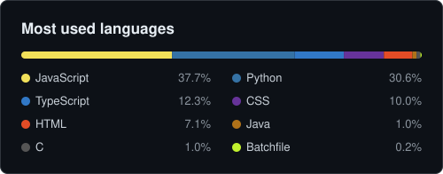

# Hi 👋, I'm [Nikhil Pratap Singh](https://nikhilsingh-me.vercel.app/)

<h3>Full-stack developer. I build software for businesses that have outgrown spreadsheets.</h3>

- 💼 Freelance full-stack developer: custom dashboards, booking and billing systems, PWAs and AI tools.
- 🏋️ My gym management system runs every day at two gyms, one with 250+ members.
- 🏫 B.Tech in Computer Science at [**Chitkara University**](https://chitkara.edu.in/).
- 🌐 See the work on my [**portfolio**](https://nikhilsingh-me.vercel.app/).
- 📧 Reach me by [**email**](mailto:nikhilpartapsingh88@gmail.com), on [**LinkedIn**](https://www.linkedin.com/in/nikhil-partap/) or on [**Upwork**](https://www.upwork.com/freelancers/~01eabcf9d4438d86f0).

<h2 align="center">📊 GitHub Stats</h2>

  <picture>
    <source media="(prefers-color-scheme: dark)" srcset="https://raw.githubusercontent.com/nikhil-partap/nikhil-partap/stats/stats-dark.svg" />
    <source media="(prefers-color-scheme: light)" srcset="https://raw.githubusercontent.com/nikhil-partap/nikhil-partap/stats/stats-light.svg" />
    
  </picture>
  <picture>
    <source media="(prefers-color-scheme: dark)" srcset="https://raw.githubusercontent.com/nikhil-partap/nikhil-partap/stats/languages-dark.svg" />
    <source media="(prefers-color-scheme: light)" srcset="https://raw.githubusercontent.com/nikhil-partap/nikhil-partap/stats/languages-light.svg" />
    
  </picture>

<h2 align="center">🛠️ Tech Stack</h2>

  <a href="https://skillicons.dev">
    
     
    
     
    
  </a>

  <picture>
    <source media="(prefers-color-scheme: dark)" srcset="https://raw.githubusercontent.com/nikhil-partap/nikhil-partap/output/github-snake-dark.svg" />
    <source media="(prefers-color-scheme: light)" srcset="https://raw.githubusercontent.com/nikhil-partap/nikhil-partap/output/github-snake.svg" />
    
  </picture>

